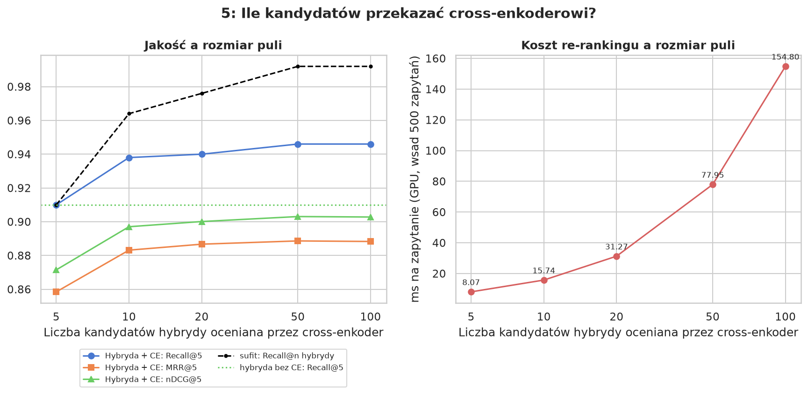

# Ilu kandydatów przekazać cross-enkoderowi?

Decyzja: cross-enkoder `cross-encoder/ms-marco-MiniLM-L6-v2` ocenia **top-50 kandydatów hybrydy RRF** dla **wszystkich 500 zapytań** ewaluacyjnych i zwraca z nich top-5. Ten dokument wyjaśnia, skąd 50 i dlaczego nie „kilka wybranych zapytań”.

## 1. Re-ranking samego top-5 nie poprawi Recall@5

Instrukcja mówi o wyszukiwaniu z `top_k = 5` i re-rankingu. Jeśli cross-enkoder dostanie tylko 5 dokumentów, które hybryda już zwróciła, może je jedynie przestawić. Zbiór 5 dokumentów się nie zmienia, więc **Recall@5 musi zostać taki sam**, a poprawić mogą się tylko MRR@5 i nDCG@5 (kolejność). Notebook sprawdza to assertem w wariancie kontrolnym „Hybryda + CE (top-5)”:

| Wariant | Recall@5 | MRR@5 | nDCG@5 |
|---|---|---|---|
| Hybryda RRF | 0.910 | 0.817 | 0.840 |
| Hybryda + CE (top-5) | **0.910** | 0.858 | 0.871 |

Żeby re-ranker mógł **odzyskać** złoty akapit spoza top-5, musi dostać szerszą pulę. Tak działa typowy potok retriever → re-ranker: tani retriever z wysokim recall, drogi re-ranker z wysoką precyzją.

## 2. Jak duża pula: sufit kontra koszt

| Pula n | Recall@5 | MRR@5 | nDCG@5 | Sufit: Recall@n hybrydy | ms/zapytanie (CE, GPU) |
|---|---|---|---|---|---|
| 5 | 0.910 | 0.859 | 0.872 | 0.910 | ~8 |
| 10 | 0.938 | 0.883 | 0.897 | 0.964 | ~16 |
| 20 | 0.940 | 0.887 | 0.900 | 0.976 | ~32 |
| **50** | **0.946** | **0.889** | **0.903** | **0.992** | ~79 |
| 100 | 0.946 | 0.888 | 0.903 | 0.992 | ~157 |

- **Sufit.** Re-ranker nie odzyska dokumentu, którego nie ma w puli, więc Recall@n hybrydy jest górną granicą. Przy n = 50 złoty akapit jest w puli dla 99.2% zapytań, a dalsze poszerzanie do 100 nie dodaje ani jednego zapytania.
- **Jakość się nasyca.** Największy skok jest z 5 na 10 (+0.028 Recall@5), potem przyrosty są małe, a 50 i 100 dają ten sam wynik.
- **Koszt rośnie liniowo**, ~1.6 ms na kandydata (GPU, RTX 5060 Laptop): cross-enkoder musi przetworzyć każdą parę (zapytanie, akapit) osobno.
- **Uwaga: to przepustowość, a nie opóźnienie.** Czasy w tabeli to obsługa wszystkich 500 zapytań jednym wsadem, podzielona przez 500. Pojedyncze zapytanie (sekcja 5.c (6) w notebooku) kosztuje więcej: dla CE top-50 mediana to ~141 ms, a p95 ~200 ms (cały potok hybryda + CE).

**Dlaczego 50, a nie 20.** Różnica jakości między 20 a 50 to tylko ~3 zapytania na 500 (Recall@5 0.940 vs 0.946), czyli na granicy szumu. 50 to jednak najmniejsza pula, przy której krzywa jakości i sufit się wypłaszczają: nie zostawiamy jakości na stole, a ~80 ms na zapytanie jest akceptowalne w zadaniu ewaluacyjnym. Gdyby liczyło się opóźnienie (np. wyszukiwarka obsługująca zapytania pojedynczo na żywo, gdzie CE top-50 to ~141 ms, albo CPU), rozsądnym wyborem byłoby **10–20**: daje ~90–95% zysku nDCG@5 z re-rankingu (względem hybrydy bez CE) przy 20–40% kosztu.

## 3. Dlaczego wszystkie 500 zapytań, a nie „wybrane”

- **Wiarygodność.** Przy 500 zapytaniach jedno zapytanie to 0.002 w Recall@5. Różnice między wariantami (np. +0.036 Recall@5 po re-rankingu) są wtedy wyraźnie większe niż szum. Na kilku zapytaniach jedna pomyłka zmienia wynik o kilkanaście punktów procentowych.
- **Porównywalność.** BM25, bi-enkoder i hybryda są ocenione na tych samych 500 zapytaniach. Ocena re-rankera na podzbiorze nie byłaby z nimi porównywalna.
- **Koszt jest pomijalny.** 500 × 50 = 25 000 par to ~40 s na GPU.
- „Wybrane zapytania” z instrukcji realizują **przykłady jakościowe** w notebooku (sekcja 5.c): zapytania, w których cross-enkoder naprawił ranking i w których go zepsuł.

## 4. Większy model (L12)

Dla porównania `ms-marco-MiniLM-L12-v2` na tej samej puli 50: Recall@5 0.960, nDCG@5 0.918 (vs 0.946 / 0.903 dla L6) przy ~2× większym koszcie re-rankingu. Pozostaję przy L6 jako wariancie głównym (decyzja z planu: najlepszy stosunek jakości do kosztu), a L12 pokazuję jako górną granicę w tej rodzinie modeli.
