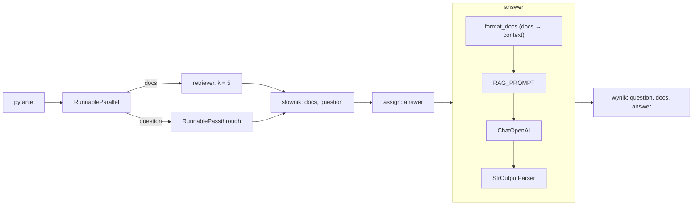

# Ściąga do obrony: RAG (Część II)

Kod: `03/utils/rag/`, eksperymenty: `03/mikolaj/mikolaj.ipynb`.

## 1. RAG w dwóch zdaniach

RAG (Retrieval-Augmented Generation) to potok z dwóch części: wyszukiwarka (retriever) znajduje akapity pasujące do pytania, a model językowy odpowiada, mając te akapity w prompcie. Po co: model dostaje wiedzę spoza swoich wag (aktualną lub prywatną), rzadziej zmyśla, a odpowiedź da się sprawdzić w źródle.

Konfiguracja poza kodem: konto na [services.clarin-pl.eu](https://services.clarin-pl.eu/login) → token API w panelu → `cp 03/.env.example 03/.env` i wpisanie `CLARIN_API_KEY` oraz `CLARIN_MODEL`. Plik `.env` jest w `.gitignore`, klucz nie trafia do repozytorium.

## 2. Przepływ łańcucha LCEL

LCEL (LangChain Expression Language) składa potok z małych kroków (`Runnable`) operatorem `|`. Każdy krok ma `invoke` (jedno wejście) i `batch` (wiele wejść, równolegle).

```python
rag_chain = (
    RunnableParallel(
        docs=RunnableLambda(lambda q: retriever.retrieve(q, k)),
        question=RunnablePassthrough(),
    )
    | RunnablePassthrough.assign(
        answer=(
            {"context": itemgetter("docs") | RunnableLambda(format_docs),
             "question": itemgetter("question")}
            | RAG_PROMPT | llm | StrOutputParser()
        )
    )
)
# rag_chain.invoke("Who ...?") -> {"question", "docs", "answer"}
```



Krok po kroku:

1. `RunnableParallel`: to samo pytanie idzie do dwóch gałęzi. Retriever daje `docs`, `RunnablePassthrough` przepisuje `question`. Wynik to słownik `{docs, question}`.
2. `RunnablePassthrough.assign(answer=...)`: dokleja klucz `answer` do istniejącego słownika, nie gubiąc `docs` i `question`.
3. Wewnątrz `answer`: `itemgetter("docs")` wyciąga listę akapitów, `format_docs` składa z niej tekst z numerami `[1]`–`[5]` i tytułami, `RAG_PROMPT` wstawia kontekst i pytanie, `ChatOpenAI` woła model CLARIN, `StrOutputParser` zamienia odpowiedź na zwykły tekst.
4. Łańcuch zwraca też `docs`, więc w analizie widać, co trafiło do kontekstu.

Łańcuch bez RAG: `plain_chain = PLAIN_PROMPT | llm | StrOutputParser()`, wejście `{"question": q}`.

## 3. Wybory i uzasadnienia

| Decyzja | Powód |
|---|---|
| SQuAD, split `validation` (ok. 10,5 tys. pytań, ok. 2 tys. unikalnych akapitów) | Są krótkie odpowiedzi wzorcowe, więc można policzyć trafność; zbiór mały, osadzenia liczą się szybko na laptopie. |
| `multi-qa-mpnet-base-dot-v1` | Model trenowany na parach pytanie–akapit, pod iloczyn skalarny. |
| `faiss.IndexFlatIP` | Iloczyn skalarny, dokładne przeszukiwanie. Przy 2 tys. akapitów jest szybkie; indeksy przybliżone (IVF, HNSW) mają sens dopiero przy milionach dokumentów. |
| `k = 5` | Kompromis między szansą trafienia a długością kontekstu i szumem. |
| Temperatura 0 | Powtarzalne odpowiedzi, łatwiejsze porównanie RAG z bez RAG. |
| Prompt RAG | Tylko podany kontekst, krótka odpowiedź, numer akapitu w nawiasach, a gdy brak odpowiedzi: dokładnie `I don't know.`. Prompty po angielsku, bo SQuAD jest po angielsku. |
| `pydantic-settings` | Klucz z `03/.env`, poza kodem; brak klucza daje czytelny błąd przy starcie. |
| Klasa abstrakcyjna `Retriever` | Retriever hybrydowy z Części I wystarczy zapisać jako podklasę, reszta potoku się nie zmienia. |
| Cache osadzeń w `03/artifacts/rag/` | Akapity koduje się raz, kolejne uruchomienia wczytują plik. |
| Pandas `DataFrame` zamiast wydruków | Wyniki w tabelach, łatwo porównać RAG z bez RAG. |

## 4. Wyniki

Próbka: 50 pytań z SQuAD, ziarno 42, `k = 5`, model: `gemma-4-31b-it` (największy ogólny model czatowy w CLARIN, dobry angielski; `pllum` jest nastawiony na polski, `llama3.1-8b` mniejszy).

| Miara | Liczba (z 50) | Udział |
|---|---|---|
| Retriever: właściwy akapit w top 5 (hit@5) | 46 | 92% |
| RAG: odpowiedź zawiera wzorzec | 44 | 88% |
| Bez RAG: odpowiedź zawiera wzorzec | 16 | 32% |
| RAG: odpowiedź `I don't know.` | 3 | 6% |

Po ręcznym przejrzeniu 6 pudeł RAG: 3 to poprawne odpowiedzi, których miara nie uznała, więc faktycznie 47/50 (94%). Pozostałe 3 to odmowy `I don't know.`, wszystkie przy złym kontekście z retrievera. Halucynacji: 0.

Przykłady do pokazania (tabela w sekcji 3 notebooka):

- **Pytanie z bazy, zależne od kontekstu**: „Who were special guests for the Super Bowl halftime show?” Bez RAG: ogólna lista artystów z różnych lat. Z RAG: „Beyoncé and Bruno Mars [2]” (Super Bowl 50).
- **Pytanie spoza bazy**: „What is the population of Wrocław?” Retriever zwraca akapity o Warszawie, RAG: `I don't know.`; bez RAG: „około 670 tys.” z pamięci, bez źródła.
- **Fałszywe założenie**: „Who invented the steam engine in Poland?” RAG: `I don't know.` (akapity o silniku parowym nie mówią nic o Polsce); bez RAG model sam prostuje założenie (Newcomen, Watt).

## 5. Błędy i ograniczenia

Kategorie błędów RAG na 6 pudłach (szczegóły w notebooku, sekcja „Analiza”):

- **(a) Retriever nie znalazł akapitu: 3** (SAP Center, patent Tesli, „Obersee”). Model za każdym razem odpowiada `I don't know.`.
- **(b) Odpowiedź poprawna, miara jej nie uznała: 3** („Saudi-based” sklejone przez normalizację w „saudibased”, „pure oxygen” wobec wzorca „pure O”, parafraza).
- **(c) Halucynacja: 0.**
- **(d) `I don't know.` mimo dobrego akapitu: 0.**

Ograniczenia:

- `contains_gold` sprawdza, czy wzorzec występuje dosłownie w odpowiedzi (po normalizacji jak w SQuAD: małe litery, bez interpunkcji i przedimków). Poprawna parafraza lub dłuższa odpowiedź bez wzorca jest liczona jako błąd, więc miara zaniża wynik. Numery cytowań `[2]` są usuwane przed porównaniem.
- Jakość RAG nie przekroczy jakości retrievera.
- Próbka 50 pytań jest mała: różnica kilku punktów procentowych to nie jest wiarygodna różnica.
- Baza to tylko artykuły z SQuAD, więc pytania spoza nich nie mają odpowiedzi w indeksie.
- CLARIN ogranicza równoległe zapytania (HTTP 429), więc pomiar idzie po kolei z ponawianiem (`with_retry`), ok. 3,5 min na 100 wywołań.
- Retriever ma blokadę (`threading.Lock`): `.batch()` z LangChain woła go z kilku wątków, a koder z FAISS przy równoległych wywołaniach wywracał proces.

## 6. Pytania prowadzącego

**Co się stanie, gdy retriever zwróci złe akapity?**
Model, zgodnie z promptem, powinien odpowiedzieć `I don't know.`; gorzej, gdy złe akapity brzmią wiarygodnie i model zmyśli odpowiedź na ich podstawie. W pomiarze retriever chybił 4 razy na 50, a w 3 z tych przypadków odpowiedź nie zawierała wzorca i za każdym razem model odmówił, zamiast zmyślać. Stąd analiza hit@5 osobno od jakości odpowiedzi.

**Czemu `k = 5`, a nie 1 albo 20?**
`k = 1` ryzykuje, że jedyny akapit jest zły. `k = 20` wydłuża prompt, dodaje szum i koszt, a model gorzej radzi sobie z długim kontekstem. Pomiar w notebooku (1000 pytań, wykres w sekcji 6): hit@1 = 71%, hit@3 = 87%, hit@5 = 93%, hit@10 = 96%, hit@20 = 99%. Do `k = 5` zysk jest duży, dalej dwukrotnie dłuższy prompt daje tylko kilka punktów.

**Czemu iloczyn skalarny, a nie cosinus?**
Model `multi-qa-mpnet-base-dot-v1` był trenowany pod iloczyn skalarny, więc `IndexFlatIP` pasuje do niego. Cosinus to iloczyn skalarny wektorów o długości 1. Ten model nie normalizuje wektorów, więc tu oba dają różne rankingi; długość wektora niesie część informacji o dopasowaniu, a model był uczony z jej uwzględnieniem.

**Jak wykryć halucynację?**
Sprawdzić, czy odpowiedź wynika z wskazanego akapitu (prompt wymusza numer w nawiasach). Można też porównać odpowiedź z akapitem ręcznie lub drugim wywołaniem modelu jako sędzią; w projekcie robię to ręcznie na przykładach błędów.

**Czym różni się RAG od dotrenowania modelu?**
Dotrenowanie zmienia wagi modelu: kosztowne, a wiedza starzeje się w wagach. RAG zostawia model bez zmian i dostarcza wiedzę w prompcie, więc zmiana bazy dokumentów nie wymaga treningu i da się wskazać źródło.

**Jak podpiąć wyszukiwanie hybrydowe?**
Napisać podklasę `Retriever` z metodą `retrieve(query, k) -> list[Doc]`, która łączy wyniki BM25 i bi-enkodera (np. z Części I), i przekazać ją do `build_rag_chain`. Reszta łańcucha się nie zmienia.

**Po co `RunnablePassthrough.assign`?**
Bez niego wynik miałby tylko odpowiedź. `assign` dokleja `answer` do słownika z `docs` i `question`, więc można ocenić, czy właściwy akapit trafił do kontekstu.
