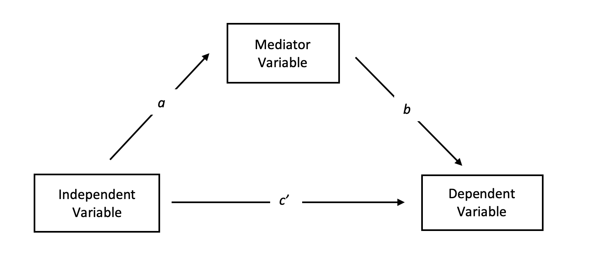

## Zadanie 4: Lokalizowanie Wiedzy i Sondowanie

## Opracowanie: dr inż. Arkadiusz Janz

Czas wykonania 3 tygodnie (oddanie lab 11)

Celem niniejszego ćwiczenia jest zapoznanie się z zagadnieniem lokalizowania i sondowania wiedzy w modelach językowych oraz zapoznanie się z technologią umożliwiającą zastosowanie znanych metod lokalizowania i sondowania w modelach opartych na architekturze autoregresywnej, takich jak GPT.

Źródło: Song Wang, Yaochen Zhu, Haochen Liu, Zaiyi Zheng, Chen Chen, and Jundong Li, *Knowledge Editing for Large Language Models: A Survey*, 2024

W ostatnich latach duże modele językowe (LLM) stały się ważnym elementem technologii językowej NLP. Dzięki znaczącej wiedzy faktograficznej i zdolności do rozumowania zdobytej podczas wstępnego treningu na dużych korpusach danych, LLM wykazują zrozumienie informacji tekstowych, potrafią analizować i generować teksty na poziomie zbliżonym do ludzkich ekspertów. Główną wadą LLM jest ogromne zapotrzebowanie na zasoby obliczeniowe podczas procesu treningu z powodu dużej liczby parametrów. Problem ten staje się coraz bardziej istotny z uwagi na ciągły napływ informacji prowadzący do konieczności aktualizacji wstępnie wytrenowanych LLM, w celu poprawienia przestarzałych informacji lub włączenia nowej wiedzy.

Jednym ze sposobów aktualizacji LLM jest naiwne dostrajanie (ang. *fine-tuning*), polegające na bezpośredniej optymalizacji parametrów wstępnie wytrenowanych LLM w celu zakodowania nowej wiedzy z nowych danych. Mimo że techniki te są szeroko stosowane, mają swoje wady, takie jak wysokie wymagania obliczeniowe i ryzyko nadmiernego dopasowania, co może prowadzić do utraty istniejącej wiedzy. Innym rozwiązaniem jest zastosowanie systemów RAG’owych, jednak ich dokładność i czas działania są zależne od etapu wyszukiwania.

Aby rozwiązać te problemy, coraz większą uwagę poświęca się technikom edycji modeli opartych na wiedzy (ang. *Knowledge-based Model Editing*, w skrócie KME). KME ma na celu precyzyjną modyfikację zachowania wstępnie wytrenowanych LLM w celu aktualizacji określonej wiedzy, bez negatywnego wpływu na inne, niezmienione informacje. Techniki KME umożliwiają efektywne i skuteczne aktualizowanie LLM o nową wiedzę bez konieczności pełnego, ponownego treningu modelu. Wymaga to jednak odpowiedniego podejścia do precyzyjnego lokalizowania wiedzy w przestrzeni parametrycznej modelu. Lokalizowanie wiedzy w modelu językowym zwykle wykorzystuje mechanizmy śledzenia przyczynowo-skutkowego (ang. *Causal Tracin*g) wywodzące się ze statystycznej procedury zwanej analizą mediacji (ang. *Mediation Analysis*). Technika ta stosowana jest często w naukach społecznych i medycznych.

Źródło: [<u>https://en.wikipedia.org/wiki/Mediation\_%28statistics%29</u>](https://en.wikipedia.org/wiki/Mediation_%28statistics%29)

W kontekście modeli językowych, zmiennymi mediacyjnymi (ang. *mediator*) są reprezentacje ukryte generowane przez poszczególne komponenty modelu. Zmienna zależna (ang. *dependent variable* lub *response variable*) to wyjście generowane przez model (np. odpowiedź na pytanie lub fakt). Zmiennymi niezależnymi (zwanymi również kontrolnymi, ang. *control variable*) są reprezentacje tokenów wejściowych. Celem takiej analizy[^1] jest zbadanie przebiegu procesu w jakim dane zjawisko zachodzi - poszukujemy objaśnienia przyczynowo-skutkowego.

Celem niniejszego ćwiczenia jest zapoznanie się z analizą mediacji w zastosowaniu do zrozumienia procesów zachodzących w ramach modelu językowego. W drugiej części ćwiczenia rezultaty analizy mediacji zostaną wykorzystane do przeprowadzenia sondowania interpretowalnej wiedzy zawartej w modelu językowym.

**Część I: Wprowadzenie do Causal-Tracing (6pkt)**

1.  Należy zapoznać się z pracą przeglądową ,,*Knowledge Editing for Large Language Models: A Survey*’’, [<u>https://arxiv.org/pdf/2310.16218</u>](https://arxiv.org/pdf/2310.16218), z naciskiem na definicję zadania i metryki oceny zadania edycji wiedzy **\[0.5 pkt\]**

2.  Należy zapoznać się z techniką *Causal-Tracing* i metodą ROME zaprezentowaną w artykule ,,*Locating and Editing Factual Associations in GPT* ’’, [<u>https://arxiv.org/abs/2202.05262</u>](https://arxiv.org/abs/2202.05262) **\[0.5 pkt\]**

3.  Należy zapoznać się z biblioteką *pyvene*: [<u>https://github.com/stanfordnlp/pyvene</u>](https://github.com/stanfordnlp/pyvene) i załączonym do dokumentacji wprowadzeniem:\
    [<u>https://stanfordnlp.github.io/pyvene/tutorials/pyvene_101.html</u>](https://stanfordnlp.github.io/pyvene/tutorials/pyvene_101.html) **\[0.5 pkt\]**

**Plan realizacji ćwiczenia**

Należy zapoznać się z kodem zawartym w ramach Notebooka \#1 wprowadzającego do biblioteki *pyvene*. Należy przeanalizować metodologię przedstawioną w skrypcie oraz funkcje spełniane przez poszczególne komponenty skryptu.

*Notebook \#1:* [<u>https://github.com/stanfordnlp/pyvene/blob/main/tutorials/basic_tutorials/Basic_Intervention.ipynb</u>](https://github.com/stanfordnlp/pyvene/blob/main/tutorials/basic_tutorials/Basic_Intervention.ipynb)

Następnie, proszę zapoznać się z Notebookiem \#2 replikującym działanie techniki Causal Tracing (element metody ROME). Należy odtworzyć notebook we własnym środowisku uruchomieniowym - będzie on stanowił podstawę do przeprowadzenia dalszych eksperymentów.

*Notebook \#2:* [<u>https://github.com/stanfordnlp/pyvene/blob/main/tutorials/advanced_tutorials/Causal_Tracing.ipynb</u>](https://github.com/stanfordnlp/pyvene/blob/main/tutorials/advanced_tutorials/Causal_Tracing.ipynb)

1.  Należy odtworzyć i uruchomić we własnym środowisku Notebook#2 (Causal_Tracing.ipynb.)

2.  Proszę przygotować 5 własnych, odmiennych, faktograficznych przykładów testowych i przedstawić dla nich wykresy aktywacji. Należy zaszumiać wyłącznie tokeny podmiotu (*subject tokens*). **\[1.5 pkt\]**

    1.  Należy wykonać analizę dla modelu gpt2-xl

Pytania pomocnicze:

- Na czym polega technika Causal Tracing?

- Które tokeny podmiotu mają największy wpływ na predykcję?

- Dlaczego wzorce aktywacji dla *attention_output*, *block_output* i *mlp_activation* różnią się?

3.  Proszę wykorzystać zbiór danych BoolQ dotyczący odpowiadania na pytania binarne ([<u>https://huggingface.co/datasets/google/boolq</u>](https://huggingface.co/datasets/google/boolq)), następnie zbadać wzorce aktywacji dla wybranych pytań ze zbioru. Analizę należy wykonać dla dwóch modeli: gpt2-xl oraz utahnlp/boolq_gpt2-xl_seed-1.**\[3 pkt\]**

    1.  Należy zmodyfikować kod w taki sposób, aby dało się prześledzić (Causal Tracing) aktywację dla wybranych przykładów (co najmniej 8-10 różnych)\
        ze zbioru BoolQ. Kod powinien być tak przygotowany, aby dało się podać na wejście dowolny przykład i zaszumić wybrane tokeny.

    2.  Zmodyfikowany kod powinien umożliwić analizę prawdopodobieństwa tokenów ,,Yes” i ,,No’’ w odniesieniu do zadanego pytania.

    3.  W eksperymentach należy zaszumiać głównie tokeny przedmiotu pytania, np. jednostki nazewnicze, o które pytamy.

    4.  Proszę przygotować odpowiednio wykresy aktywacji i dokonać ich analizy zestawiając z rezultatami uzyskanymi w punkcie 2 tej części. Proszę porównać rezultaty uzyskane za pomocą dwóch modeli.

Pytania pomocnicze:

- Dlaczego wzorce aktywacji dla modelu boolq_gpt2-xl_seed-1 są nieco inne niż w

  przypadku modelu gpt2-xl? Na czym polegają różnice?

- Czym różnią się wzorce aktywacji w porównaniu do wzorców uzyskanych w punkcie 2?

**Część II: Sondowanie (ang. *Probing*) (4pkt)**

Sondowanie (ang. *Probing*) to technika używana w dziedzinie przetwarzania języka naturalnego (NLP), której celem jest zrozumienie, jakie informacje są przechowywane w wewnętrznych reprezentacjach modeli językowych. Polega na tworzeniu prostych zadań diagnostycznych w formie klasyfikatorów, które mają na celu „sondowanie” modelu w celu odkrycia, jakie cechy językowe lub strukturalne są przez niego uchwycone. Na przykład, można użyć probing do sprawdzenia, czy model rozumie składnię, semantykę, czy relacje między słowami. Technika ta jest istotna, ponieważ pomaga badaczom ocenić, w jaki sposób i na jakim poziomie model przetwarza informacje, co może prowadzić do lepszego zrozumienia jego działania i ewentualnych ograniczeń.

1.  Należy się zapoznać z materiałem zawartym w prezentacji Mohit Iyyer odnośnie sondowania:\
    [<u>https://people.cs.umass.edu/~miyyer/cs685_f20/slides/19-probes.pdf</u>](https://people.cs.umass.edu/~miyyer/cs685_f20/slides/19-probes.pdf)

2.  Publikacja dotycząca sondowania: [<u>https://arxiv.org/abs/2102.12452</u>](https://arxiv.org/abs/2102.12452)

3.  Proszę zapoznać się z Notebookiem \#3 dotyczącym sondowania modeli językowych:\
    [<u>https://github.com/stanfordnlp/pyvene/blob/main/tutorials/advanced_tutorials/Probing_Gender.ipynb</u>](https://github.com/stanfordnlp/pyvene/blob/main/tutorials/advanced_tutorials/Probing_Gender.ipynb)

    Szczególną uwagę należy zwrócić na implementację pętli uczącej.

**Plan realizacji ćwiczenia**

1.  Proszę przygotować dane do nauczenia sondy (ang. *probe* lub *linguistic probe*) i przeprowadzić dla niej badania posługując się metodologią przedstawioną w Notebooku \#3. W przykładzie z Notebooka \#3 autorzy rozpoznawali płeć w oparciu o reprezentacje wynikające z zadanego kontekstu wejściowego. Należy zmodyfikować Notebook \#3 w taki sposób, aby rozwiązać inne zadania z jego użyciem. Należy przygotować co najmniej 2 różne zadania. **\[4 pkt\]**

    Sugerowane zadania:

    1.  Rozpoznawanie pomieszczenia, w którym znajduje się osoba (kitchen, bathroom, bedroom, itd.) na podstawie kontekstu sytuacyjnego. W tym celu można skorzystać z wybranych przykładów ze zbioru tasksource/babi_nli i ustawić zadanie w następujący sposób.

        Dla podzbioru ,,agents-motivations’’ i zawartych w nim par tekstów, w których drugi tekst kończy się pomieszczeniem:

\[ Yann is tired.\] \[ Yann will go to the bedroom. \]

przygotować przykłady uczące dla sondy (oraz przykłady testowe):

> \[ Yann is tired. Yann will go to the \] etykietka: \[ bedroom \]
>
> następnie zebrać reprezentacje ukryte do wyuczenia sondy. **Najlepiej uwzględnić wyłącznie przykłady, w których label jest równe 1 (entailed).** Wyuczyć sondę na reprezentacjach ukrytych i zweryfikować wpływ poszczególnych reprezentacji z różnych tokenów i różnych warstw (podobnie jak w Notebooku \#3) na skuteczność rozpoznawania etykietki.
>
> Przykładowy, wynikowy zbiór:
>
> \[ Yann is tired. Yann will go to the \] etykietka: \[ bedroom \]
>
> \[ Yann is hungry. Yann will go to the \] etykietka: \[ kitchen \]
>
> \[ Yann is bored. Yann will go to the \] etykietka: \[ living \]

2.  Koreferencja - należałoby przekształcić podzbiór ,,compound-coreference’’ w taki sposób, aby rozpoznawać pomieszczenie, w którym znajduje się osoba.

    Dla podzbioru ,,compound-coreference’’ i par w nim zawartych, należy przekształcić przykłady treningowe:

> \[ John and Daniel went to the office. After that they went back to the kitchen. \]

\[ John is in the kitchen \]

i stworzyć przykłady uczące dla sondy (oraz przykłady testowe):

> \[ John and Daniel went to the office. After that they went back to the kitchen. John is in the \] etykietka: \[ kitchen \]
>
> **Najlepiej uwzględnić wyłącznie przykłady, w których label jest równe 1 (entailed).**

3.  Rozpoznawanie koloru zwierzęcia dla podzbioru ,,basic-induction’’ (wnioskowanie indukcyjne) lub rozpoznawanie jakiego zwierzęcia boi się dana osoba dla podzbioru ,,basic-deduction’’ (wnioskowanie dedukcyjne).

    **Najlepiej uwzględnić wyłącznie przykłady, w których label jest równe 1 (entailed).**

[^1]: Analiza mediacji: [<u>https://www.publichealth.columbia.edu/research/population-health-methods/causal-mediation</u>](https://www.publichealth.columbia.edu/research/population-health-methods/causal-mediation)
